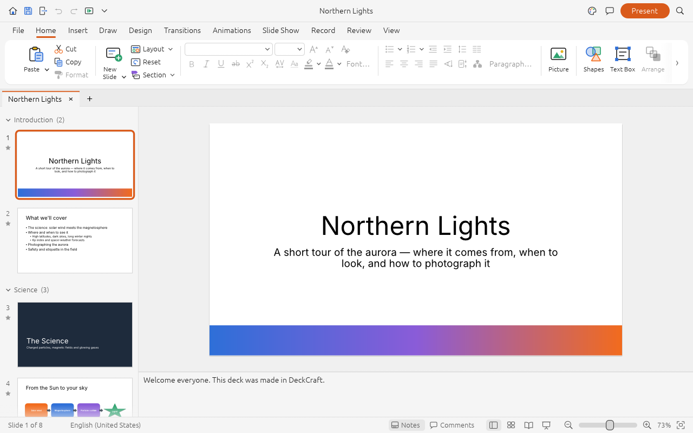

# DexDeckCraft

La interfaz de escritorio de [DeckCraft](https://github.com/storytold/deckcraft) en Android, pensada
para **Samsung DeX** y para el modo de ventanas de escritorio de Android (monitor, ratón y teclado).
También funciona en tabletas y móviles, con el dedo y el teclado en pantalla.

La app tiene la misma disposición que DeckCraft en escritorio (cinta, miniaturas, notas, vista
Backstage, paleta de comandos, presentación con diapositivas) y sus funciones. No se reescribe la
interfaz: se compila para Android la propia interfaz egui de DeckCraft (`deckcraft-ui-egui`) y se le
añade una capa de plataforma Android, la misma que usan
[DexPdfCraft](https://github.com/manoloGith/DexPdfCraft),
[DexGridCraft](https://github.com/manoloGith/DexGridCraft) y
[DexWordCraft](https://github.com/manoloGith/DexWordCraft).



> Estado: **0.1.0, sin probar aún en un dispositivo**. Todas las fases del
> [plan](docs/plan.md) están hechas y comprobadas hasta donde se puede sin dispositivo (tests,
> la interfaz en una ventana de escritorio, comprobación de tipos para Android y el APK de la CI).
> La lista de lo que hay que probar en el dispositivo está en [docs/pruebas.md](docs/pruebas.md).

## Cómo está hecho

```
DexDeckCraft/
├── upstream/                  submódulo: fork manoloGith/deckcraft, rama dexcraft/android
├── craft-android/             submódulo: manoloGith/craft-android (capa Android compartida + winit)
├── apps/dexdeckcraft/         el crate Rust de la app (cdylib que carga Android)
│   ├── src/lib.rs             DeckApp: arranca la interfaz de DeckCraft como su binario de escritorio
│   ├── src/tabs.rs            pestañas de presentaciones bajo la cinta
│   ├── src/prefs.rs           preferencias (ui.json, prefs.json) y tema del sistema
│   ├── src/android/           android_main, los Services de DeckCraft sobre craft-android, sonido
│   ├── src/main.rs            la misma ventana en escritorio, para iterar sin dispositivo
│   └── android/               proyecto Gradle: MainActivity : CraftActivity + manifiesto para DeX
├── scripts/                   sync-upstream.sh (rebasa el fork sobre storytold/deckcraft)
├── fastlane/metadata/         F-Droid / Obtainium
└── docs/                      plan, fork, pruebas en el dispositivo, releases
```

- **Motor e interfaz**: los crates de DeckCraft (`upstream/crates/*`) se usan como dependencias por
  ruta, desde un fork que solo añade unos pocos commits para Android ([docs/fork.md](docs/fork.md)).
  Actualizar es rebasar esa rama sobre upstream (`scripts/sync-upstream.sh`).
- **Capa Android**: [craft-android](https://github.com/manoloGith/craft-android) pone el ratón, el
  teclado físico y en pantalla, los insets, el ciclo de vida, los documentos (Storage Access
  Framework con escritura de vuelta), el portapapeles, la impresión y el diagnóstico.
- **Interfaz**: egui 0.37 y winit (los forks fijados de storytold, con los parches de Android de
  craft-android). wgpu dibuja con Vulkan o GLES; si no arranca, glow (OpenGL ES).

## Compilar

Requisitos:

- `rustup` (instala la versión y los targets de `rust-toolchain.toml`)
- `cargo install cargo-ndk --version 4.1.2 --locked`
- Android SDK (plataforma 36, build-tools 36.0.0) y NDK 29.0.14206865
- JDK 17 o superior

Clona con los submódulos:

```bash
git clone --recursive https://github.com/manoloGith/DexDeckCraft
```

El APK de depuración (arm64-v8a para el dispositivo, x86_64 para el emulador):

```bash
cd DexDeckCraft/apps/dexdeckcraft/android && ./gradlew assembleDebug
```

Solo arm64, que es más rápido:

```bash
./gradlew assembleDebug -Pdexdeckcraft.abis=arm64-v8a
```

Instalar en un dispositivo conectado:

```bash
adb install -r app/build/outputs/apk/debug/app-debug.apk
```

La misma ventana en escritorio Linux, sin dispositivo (con `--sample`, la presentación de ejemplo):

```bash
cargo run -p dexdeckcraft --features desktop -- --sample
```

El CI (`.github/workflows/android.yml`) compila el APK en cada push y lo deja como artefacto
(`dexdeckcraft-debug-apk`). Cómo publicar una versión: [docs/releasing.md](docs/releasing.md).

## Licencia y marcas

MIT o Apache-2.0, como DeckCraft. Los logotipos de ArtCraft no se usan, y el icono es propio: ver
[NOTICE.md](NOTICE.md).
